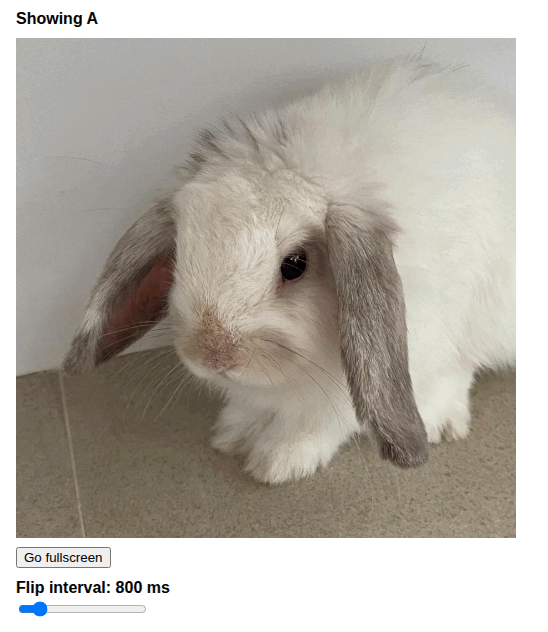

# flicker

Minimal image quality flicker tool: flip between original and compressed images, tune interval, and quickly spot subtle artifacts via blink comparison.

## Demo

[](https://castlabs.github.io/flicker/)

[Open the live demo](https://castlabs.github.io/flicker/)

## Features

- Alternates between two images (`A` and `B`)
- Adjustable flip interval (`200ms` to `5000ms`)
- Per-image source selection:
  - local upload
  - URL
  - fallback to defaults (`stem-org.jpg`, `stem-os.jpg`)
- Fullscreen support:
  - `Go fullscreen` button
  - image double-click

## Run locally

Open `index.html` in a browser.

For local HTTP serving (optional):

```bash
cd git
python3 -m http.server 8000
```

Then open `http://localhost:8000`.
